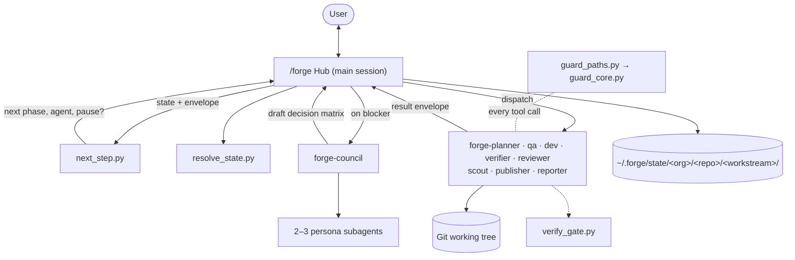

# High-Level Design: Forge

## Problem

A single coding-agent session that plans, tests, implements, reviews, and publishes a change carries every role's context at once. It loses track of which stage it is in, edits tests to make code pass, overwrites code the developer wrote by hand, pushes work that no independent check has passed, and forgets everything when the session ends. Each failure is cheap to cause and expensive to notice.

Developers who want agent help across a whole change — from ticket to merged branch — need the roles kept apart, the transitions checked by something other than the agent's own judgment, their own edits respected, and the ability to stop and resume a change days later.

## Approach

Forge is a hub-and-spoke orchestration system for Claude Code.

### Hub and spokes

The **Hub** is the `/forge` skill (the Commander) running in the user's main Claude Code session. It is the only component that talks to the user. It dispatches **spokes** — Claude Code subagents, each with one role and a fixed write boundary — and receives a structured **result envelope** from each. Spokes never talk to each other.

| Spoke | Role | Writes |
|---|---|---|
| `forge-planner` | Design and specs (LID stages 1–4, or a `PLAN.md` for non-LID repos) | `.lid/**`, `docs/**`, `PLAN.md` |
| `forge-qa` | Tests (skeletons, full tests, contract repairs) | Test paths; spec markers, set by script |
| `forge-dev` | Production code (stubs, full implementation) | Production paths; spec markers, set by script; never tests |
| `forge-verifier` | Mechanical gate: trailers, boundaries, test run, arrow audit, scope delta | Nothing in the repo |
| `forge-reviewer` | Qualitative review, internal or of an external PR | Nothing in the repo |
| `forge-scout` | Read-only recon: GitHub issues, PR diffs and threads, CI logs | Its own cache in workstream state |
| `forge-publisher` | Push the branch, or confirm a local merge into `main` is possible and hand it to the user, behind the publish gate | Remote branch (push only) |
| `forge-reporter` | PR creation and updates, PR review submission | External APIs |

The **Council** (`forge-council`) is a read-only spoke the Hub dispatches only when another spoke escalates a blocker. It fans out to two or three persona subagents (`forge-council-pm`, `-architect`, `-sec-ops`, `-debugger`, `-senior-dev`, `-critic`), and returns one draft decision matrix. The Hub presents it to the user, records the approved ruling, and routes the resulting work.

### Scripts own the deterministic work

Everything that can be decided mechanically is decided by a Python script (standard library only), not by a prompt:

- **`resolve_state.py`** — derives the workstream identity (`<org>/<repo>/<workstream>`) from git, manages the workstream lock, detects drift between the recorded HEAD and the actual HEAD, marks memory anchored to rolled-back commits as stale, and lists the repo's open workstreams.
- **`next_step.py`** — the router. Given the workstream state and a spoke's result envelope, it returns the next phase, the agent and mode to dispatch, whether to pause for the user, and the updated state. It is the only writer of routing state.
- **`verify_gate.py`** — checks commit trailers and write boundaries over a commit range, checks that no agent commit modified human-authored lines without a recorded approval, and evaluates the publish gate.
- **`guard_core.py`** — the per-tool-call guard logic: kill switch, duplicate-call circuit breaker, read-only roles, path boundaries.
- **`forge_memory.py`** — loads an agent's episodic memory, marking notes anchored to commits the branch no longer contains.
- **`forge_hub.py`** — the Commander's mechanical steps: classifying the `/forge` argument, composing the resume brief, and picking up result envelopes and user answers as router events.
- **`forge_spoke.py`** — the spokes' mechanical steps: reading the invocation, committing with Forge trailers written from state, completing and checking the result envelope, and reporting scope facts.
- **`lid_check.py`** — structural LID checks for the verifier: every workstream spec has a test and a code tag, and every `@spec` annotation names a real spec.

The Hub prompt handles what needs judgment: talking to the user, naming workstreams, dispatching, and presenting Council output. Envelopes travel between the Hub, the router, and spokes as files, so no model retypes them.

### Git as the provenance record

Every commit a spoke makes carries `Forge-Agent`, `Forge-Stage`, `Forge-Mode`, and `Forge-Input-SHA` trailers. A commit without a `Forge-Agent` trailer is a human commit. Workstream state records SHA anchors (`plan_base_sha`, `last_known_head_sha`, `verifier_pass_sha`, `reviewer_pass_sha`); publishing requires a clean tree and `HEAD == verifier_pass_sha == reviewer_pass_sha`.

### Human-authored code

A line is **human-authored** when `git blame` attributes its current content to a commit without a `Forge-Agent` trailer. Uncommitted changes are turned into such a commit (a `wip(user):` checkpoint, on the user's choice) before any mutating spoke runs, so they fall under the same rule. A spoke that needs to modify or delete human-authored lines stops and returns a request instead; the change proceeds only after the user approves it, and the approval is recorded in workstream state. `verify_gate.py` enforces the rule after the fact over each spoke's commits, so attribution is computed from git, never judged by an agent.

### Workstream state outside the repo

Each workstream runs in its own git worktree, which Forge creates under the harness's worktree root (`.claude/worktrees/` for Claude Code), on a new branch from the default branch or — for stacked work, and only after the user confirms — from another branch. Its state lives under `~/.forge/state/<org>/<repo>/<workstream>/`: `state.json`, a lock file, scout and council caches, and partitioned episodic memory. Nothing Forge writes for orchestration lands in the repo. On closeout the Hub archives or deletes the workstream directory.

### Forge memory

The `forge-memory` skill loads and saves each agent's episodic notes (decisions, dead ends, tooling quirks), each anchored to a commit SHA. The Hub owns `memory/hub/` and is the only writer of `memory/shared/`; each spoke reads `memory/shared/` and reads and writes only its own partition. Forge memory is self-contained: it neither reads nor writes any other memory tool's store, and a user who wants to keep something beyond the workstream records it with their own tools.

### Listing and resuming

`/forge list` shows the repo's open workstreams — phase, last status, last update, lock holder, branch and worktree — so the user can pick one. `/forge <workstream>` resumes it with a five-line resume brief before anything is dispatched. Without an argument, `/forge` resolves the workstream from `$FORGE_WORKSTREAM`, then from the current branch; on `main`/`master` with no state it shows the list. Resuming a workstream from outside its worktree moves the session into that worktree; no checkout changes.

`/forge stop` sets the kill switch and `/forge resume` clears it and continues. `/forge mode <mode>` switches the current workstream's mode. `/forge drop <workstream> <reason>` abandons a workstream before it finishes: its state is archived with the reason, and its branch is kept.

`/forge <issue or task description>` starts a new workstream. Forge names it — from the GitHub issue's number, title, and labels when there is one, otherwise from the task description, which it keeps with the workstream for the planner to read — creates the worktree and branch, and moves the session there. It stops to ask only when an open workstream already tracks the same issue, when the description gives nothing to name, or when the branch would start from anything other than the default branch.

## Target Users

- **A developer driving one change end to end** in a repository they own, who wants agents to do the bulk of planning, testing, and implementation while they keep approval over plans, spec changes, and anything that touches their own code — or hand a change over entirely and approve only its publishing.
- **A developer working collaboratively with the agents** — writing some code or tests by hand between agent passes — who needs the agents to pick up their commits as ground truth rather than fight them.
- **A developer running several changes in parallel** across branches or worktrees, who needs each change's state isolated and resumable.

## Goals

- A change goes from issue to published branch with every phase transition decided by `next_step.py` and every gate checked by a script.
- No agent commit modifies a test file unless the agent is `forge-qa`, and no agent commit modifies human-authored lines without a recorded approval; `verify_gate.py` detects any violation.
- Publishing is impossible unless the verifier and reviewer both passed the exact current HEAD on a clean tree.
- Any workstream can be resumed in a fresh session from its state alone, with the resume brief correct about phase, progress, and next step.
- Workstream state never leaks into the repo or into another workstream.
- Scripts, spoke skills, Council, `forge-spoke`, and `forge-memory` live in `reference/` with no Claude-specific content, so another CLI can adopt them with its own adapter.

## Non-Goals

- **Other CLIs.** Only Claude Code gets an adapter and installer. `reference/` stays reusable, but no Codex, Antigravity, or Pi wiring ships.
- **Repo-wide knowledge management.** Forge memory is scoped to a workstream and disposed of at closeout. Forge does not promote notes beyond the workstream.
- **Prompt-behavior evaluation suites.** Correctness of the deterministic scripts is tested; behavioral evals of spoke prompts are out of scope.
- **Jira and other non-GitHub trackers.** Scout and reporter work with GitHub (issues, PRs, Actions) through `gh` only.
- **Bootstrapping linked-intent development.** A repository is planned with LID only when it already has LID structure; otherwise Forge plans with a `PLAN.md`. Adding LID to a repository is the user's job, with their own tools.
- **Autonomous recovery from ambiguous state.** Forge does not guess its way out of drift, dirty trees, or contested locks.

## Tenets

1. **Scripts over prompts.** When a rule can be checked mechanically, a script owns it; prompts handle only judgment.
2. **Human code is ground truth.** Agents adapt to human-authored code and tests, and change them only with the user's explicit approval.
3. **Stop over guess.** When state is unclear, stop and ask rather than recover automatically.
4. **Shared first.** When content can be CLI-neutral, it lives in `reference/`, even at some cost to Claude-specific polish.

## System Design

### Repository layout

```text
rev                          # upstream pins: one entry per dependency, a main-branch commit
reference/                   # CLI-neutral
  scripts/                   # resolve_state.py, next_step.py, verify_gate.py, guard_core.py,
                             # forge_memory.py, forge_hub.py, forge_spoke.py, lid_check.py
    tests/                   # pytest suite
  skills/
    forge-spoke/             # the dispatch procedure every spoke follows
      scripts -> ../../scripts
    forge-memory/            # load / save episodic memory
      scripts -> ../../scripts
    forge-planner/  forge-qa/  forge-dev/  forge-verifier/
    forge-reviewer/ forge-scout/ forge-publisher/ forge-reporter/
    forge-council/           # council orchestration + personas/<persona>.md charters
claude/                      # Claude Code adapter
  installer.sh               # install (--global | --project), --plugin, --preset, --models, --uninstall, --vendor
  skills/forge/SKILL.md      # Commander (Hub)
  skills/forge/scripts -> ../../../reference/scripts
  skills/forge-*  -> ../../reference/skills/forge-*
  agents/forge-*.md          # subagent profiles: tool limits, preloaded skills; the installer adds model and guard
  hooks/guard_paths.py       # PreToolUse adapter: reads agent_type, calls guard_core (installed beside it)
docs/                        # Forge's own LID design tree
```

### Runtime topology



### Phase flow

Planning runs LID stages 1–4 (or naive planning), either stopping for approval after each stage or chaining until done or blocked. Build runs QA full → Dev full, or a two-pass flow (QA skeletons → Dev stubs → QA full → Dev full, with the verifier recomputing remaining scope after every pass so human commits shrink it). Then final verification, internal review, publish, CI watch, and report. The complete phase set and transition table live in the router design and are implemented only by `next_step.py`.

### Modes

Each workstream runs in one named **mode** that decides where it stops for the user:

| Mode | Planning | Code |
|---|---|---|
| `delivery` | Chains to the finished plan with no approval | No pauses; council rulings that do not ask for the user are applied |
| `collab-plan` | Stops after every LID stage | No pauses |
| `collab-qa` | One approval of the finished plan | Pause to edit after the tests are written |
| `collab-dev` | One approval of the finished plan | Pause to edit after the code is written |
| `collab-code` | One approval of the finished plan | Two-pass flow, pausing after skeletons, stubs, and full tests |
| `collab` | Stops after every LID stage | Two-pass flow, pausing after skeletons, stubs, and full tests |

Every mode still stops for publishing, for changes to human-authored code beyond what the approved plan covers (in `delivery`, choosing the mode approves the plan), for uncommitted changes, for attempt limits, for council rulings that need the user, and on any error or the kill switch. New workstreams take the default mode from `~/.forge/config.json` (`collab` when unset), or the one named at start; the user switches mode at any time, and the new mode governs every step not yet started.

### Installation

`claude/installer.sh` installs Forge from the `claude/` tree, copying files with every link resolved, so an install never depends on the checkout staying in place and never runs edits nobody reinstalled. Links inside the repository only assemble each CLI's layout from `reference/`. Rerunning the installer picks up changes. It has two modes, and one machine uses one of them:

- **Plain files** (default). Skills are copied into `~/.claude/skills/` (`--global`, the default) or `<repo>/.claude/skills/` (`--project <repo>`). Agents are written as generated profiles carrying their model and a `PreToolUse` guard hook in their frontmatter, so the guard runs only inside Forge agents, once per call, Council personas included. `guard_paths.py` is copied into the Commander skill's `scripts/` beside `guard_core.py`. Project scope writes `.claude/settings.local.json` and lists every installed file in `.git/info/exclude`, touching no tracked file; one repository uses one scope.
- **Plugin** (`--plugin`). The installer builds a Claude Code plugin from the same tree: the same skills and generated agents, with the guard as a plugin-wide `PreToolUse` hook, because Claude Code ignores frontmatter hooks in plugin agents. Claude Code names plugin agents `forge:forge-<role>`, so the Commander and Council dispatch those names and the guard accepts them. An organization can force-enable the plugin in managed settings, the one way the guard runs under a policy that allows managed hooks only.

In both modes the installer sets each agent's model from a preset — `balanced` (the default), `sonnet`, `opus`, `fable-opus`, or `fable` — or from `--models FILE`, a JSON map from agent name to model with an optional `default`. It grants the state directory with `permissions.additionalDirectories` and an `Edit` allow rule for it, in the scope's settings file (`~/.claude/settings.json`, backed up first, for the global scope and the plugin; `settings.local.json` for a project). It records what it wrote in a manifest, and `--uninstall` removes exactly that. It refuses to install in a second mode or scope over an existing install: two guards on one call trip the duplicate-call circuit breaker.

A guard can be absent without any error: Claude Code skips agent frontmatter hooks in `-p` sessions and in folders whose workspace trust was not accepted, and a managed policy (`allowManagedHooksOnly`, `strictPluginOnlyCustomization`) blocks every hook except managed ones and those of force-enabled plugins. The guard therefore records each call it checks against the dispatch it serves, and the router refuses a spoke's result when the dispatch has no record, stopping with `GUARD_INACTIVE`.

The installer reads `rev` and compares each pinned Claude Code plugin against the `gitCommitSha` recorded in `~/.claude/plugins/installed_plugins.json`: a missing required plugin fails the install, a commit mismatch warns. `--vendor` clones every pinned dependency at its pinned commit into a gitignored `.vendor/`, which backs a sandboxed Claude Code session for trying Forge without touching the user's real configuration.

### Dependencies

- **Required:** the `linked-intent-dev` Claude Code plugin, which the planner follows for LID stages 1–4.
- **Provenance only:** upstream sources Forge's Council personas and memory format are adapted from are pinned in `rev` so they can be diffed later; nothing is installed from them.

## Key Design Decisions

| Decision | Alternatives considered | Rationale |
|---|---|---|
| `next_step.py` owns routing and is the single writer of routing state | Hub prompt reads the routing table and routes; Hub proposes transitions and a script validates them | Routing becomes testable with pytest, and a single writer prevents state from diverging. Validating Hub proposals would keep routing logic in both prose and a table. |
| Human-authored code is identified per line by `git blame` plus the `Forge-Agent` trailer | Per file (any file a human commit touched); explicit ownership markers in code | Per-line attribution is computed from git, needs nothing from the user, and protects exactly what the human wrote. Per-file is so coarse it blocks agents from files they share with the user; markers depend on the user remembering to add them. |
| Workstream state is JSON | YAML with PyYAML | Every script runs on the Python standard library with no install step. |
| Council is one subagent that fans out to personas | The Hub dispatches each persona directly | Keeps raw persona output out of the main session; the Hub still owns user sign-off and the recorded ruling. |
| The router checks that the guard ran for every dispatch | Trust that the installed guard runs; the verifier checks it at its own phases | Claude Code skips hooks silently in several cases. A script check on every result catches all of them, the verifier's own dispatches and the spokes after `VERIFY_FINAL` included. |
| Guard identifies the acting agent from the hook input's `agent_type` | An environment variable set per agent | Claude Code reports the subagent name to hooks; an environment variable cannot be set per subagent. |
| One worktree per workstream, created by Forge | The user creates branches; work in the main checkout | A worktree isolates each change, lets several run in parallel, and lets Forge move the session between workstreams without touching any checkout. |
| Install by copying from `claude/`, as plain files or as a plugin | Symlinks into the checkout; plain files only; plugin only | A copy keeps working when the checkout moves and runs only what was installed. Plain files keep the guard in each agent's frontmatter, scoped to Forge agents; a plugin cannot, but it is the only install a managed hooks-only policy can allow. |
| Skills, agents, and personas are all named `forge-*`; the Hub is `/forge` | Unprefixed role names | Role names like `dev` and `qa` collide with other installed skills and agents. |
| Pacing is one named mode per workstream, switchable at any time | Separate settings for planning cadence, build flow, and council auto-apply; modes combined per workstream | One name per workstream is easier to choose and to read in the resume brief than a combination; the router derives every pause from it, so there is no second setting to drift. |
| Each agent's model is set at install, from a named preset or a file | Fixed aliases in each profile; the router picks a model per dispatch | An agent profile's `model:` overrides the session's model, so the install decides what each agent runs on, and the user trades cost against quality per install. Routing and Council stay free of model choice. |

## Success Metrics

- The pytest suite covers every row of the routing table, every role × path combination in the guard, the publish gate, drift detection (fast-forward, rewind, dirty tree), SSH and HTTPS remotes, linked worktrees, and per-line human-code attribution — and passes.
- A full workstream can be run in the vendored sandbox from `/forge` to publish without manual state edits.
- **Falsification signals:** a spoke's result is accepted although its guard never ran; an agent commit lands that edits a test from `forge-dev`, or modifies human-authored lines without a recorded approval, and `verify_gate.py` passes it; a publish succeeds with `HEAD` differing from either pass SHA; a resume brief names the wrong phase or next step; any file under `~/.forge/` appears in the repo.

## References

- `docs/notes.md` — original blueprint for Forge across four CLIs.
- Linked-intent development (`linked-intent-dev` plugin) — the planner's methodology.
- Claude Code subagents and hooks documentation — subagent nesting, `agent_type` in hook input, per-agent tool limits, frontmatter hooks and when they are skipped.
- Claude Code settings and plugins references — `allowManagedHooksOnly`, `strictPluginOnlyCustomization`, force-enabled plugins, plugin component namespacing.
